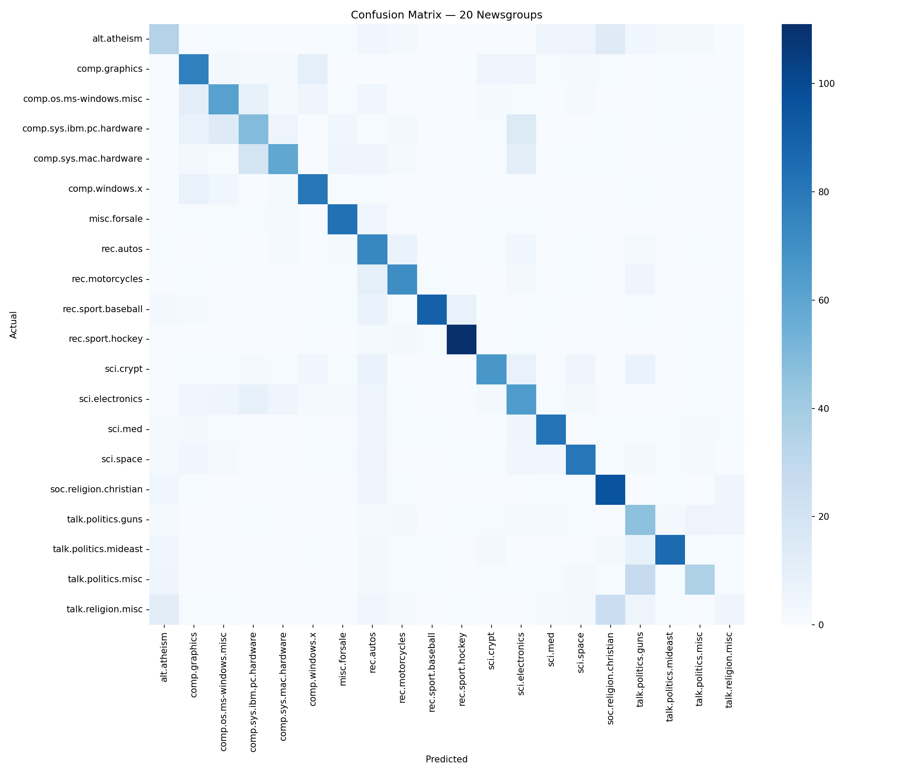
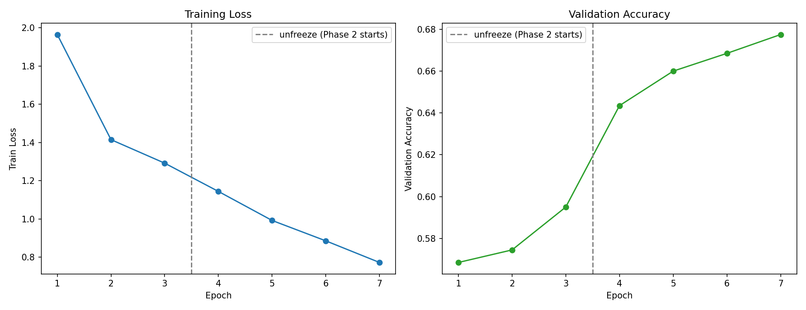

# Semantic Document Classifier

Fine-tunes DistilBERT with a custom classification head to route unstructured text into one of 20 topic categories — the kind of problem that shows up as support ticket routing, document tagging, or content filtering in production systems.

Built with a manual two-phase PyTorch training loop (no `Trainer` API) and a hand-attached classification head (no `AutoModelForSequenceClassification`), so every part of the forward/backward pass is explicit. Served via FastAPI with single and batch prediction endpoints.

## Architecture

```
Text --> AutoTokenizer --> input_ids + attention_mask
                                |
                    DistilBERT backbone (frozen Phase 1,
                    last 2 layers unfrozen Phase 2)
                                |
                  [CLS] token --> Linear(768, 256) --> ReLU --> Dropout(0.5) --> Linear(256, 20)
                                |
                          20-class logits
```

## Two-phase training

**Phase 1 — head only, backbone frozen.** The classification head starts with random weights. Training it jointly with the pretrained backbone risks corrupting those weights with noisy early gradients, so the backbone stays frozen while the head stabilizes. AdamW at `lr=1e-3` with cosine annealing, 3 epochs.

**Phase 2 — last 2 layers unfrozen.** With the head trained, the last two transformer layers unfreeze for fine-tuning at a much lower `lr=2e-5`. Full unfreeze of all 66M params on a dataset this size would overfit fast; the last two layers hold the most task-specific representations, which is a reasonable middle ground. Gradient clipping (`max_norm=1.0`) matters here specifically — now that pretrained weights are being updated directly, a bad batch can produce a gradient spike large enough to meaningfully damage them.

Ran for 4 epochs instead of the originally planned 2 — accuracy was still climbing with no sign of leveling off at epoch 2.

## Results

| Metric | Value |
|---|---|
| Test accuracy | 67.75% |
| Total parameters | 66,564,884 |
| Trainable (Phase 1) | 202,004 (head only) |
| Trainable (Phase 2) | 14,377,748 (head + last 2 layers) |
| Training hardware | Local CPU (M1) |
| Phase 1 time | ~27 min (3 epochs) |
| Phase 2 time | ~52 min (4 epochs) |

Training ran on CPU, which capped how much hyperparameter search and extra training time was practical within the project's time budget — each Phase 2 epoch took roughly 13 minutes. 67.75% is the accepted result for this pass of a correctly-implemented two-phase strategy; the per-class breakdown below matters more for understanding the model than the headline number does.

### Most confused category pairs

| Pair | Why |
|---|---|
| `talk.politics.guns` / `talk.politics.misc` | Both political and argumentative in tone; `talk.politics.misc` is effectively a catch-all for political posts that don't fit a narrower bucket, including gun-related ones. |
| `soc.religion.christian` / `talk.religion.misc` | Same underlying vocabulary (scripture references, denominational terms) — the real distinguishing signal is posting style and community rather than topic content. |
| `comp.sys.ibm.pc.hardware` / `comp.sys.mac.hardware` | Both are hardware troubleshooting posts; without the one or two platform-specific terms, the surrounding language about drivers and error messages is nearly identical. |

### Confusion matrix



### Training curves



## API

Four endpoints, model loaded once at startup (not per request).

| Endpoint | Method | Description |
|---|---|---|
| `/health` | GET | Service status and model info |
| `/labels` | GET | All 20 category names |
| `/classify` | POST | Single-text prediction with top-3 confidences |
| `/classify/batch` | POST | Batch prediction, max 32 texts per request |

### Run it

```bash
pip install -r requirements.txt
uvicorn api.main:app --reload --host 0.0.0.0 --port 8000
```

Swagger UI: `http://localhost:8000/docs`

### Example requests

```bash
curl http://localhost:8000/health
```

```bash
curl http://localhost:8000/labels
```

```bash
curl -X POST http://localhost:8000/classify \
  -H "Content-Type: application/json" \
  -d '{"text": "I need help with my GPU drivers on Windows 11"}'
```

```bash
curl -X POST http://localhost:8000/classify/batch \
  -H "Content-Type: application/json" \
  -d '{"texts": ["The Yankees won last night", "NASA launched a new satellite"]}'
```

## Project structure

```
Semantic Document Classifier/
├── notebooks/
│   └── train.ipynb              # data prep, training, evaluation
├── src/
│   ├── model.py                 # CustomClassifier
│   ├── dataset.py                # NewsgroupsDataset
│   └── evaluate.py               # accuracy + prediction helpers
├── api/
│   ├── main.py                   # FastAPI app
│   └── schemas.py                # Pydantic request/response models
├── models/
│   └── portfolio_classifier.pth
├── reports/figures/
│   ├── confusion_matrix.png
│   └── training_curves.png
└── requirements.txt
```
